# Campus Event Management System (CEMS)

A locally runnable prototype for requesting, reviewing, confirming and cancelling campus events. It prevents venue conflicts, respects capacity, and handles maintenance and renovation blocks.

Built for the IIIT Hackathon Challenge by a 7-member team. The work was done in 7 incremental steps, one member per step (see [PLAN.md](PLAN.md)).

## Prerequisites

- Python **3.10+** (developed on 3.13)
- Git

No cloud services, external APIs or database server are needed. Data lives in a local SQLite file, `cems.db`, which is created automatically.

## Setup

```bash
git clone https://github.com/H9660/Ms_hackathon_group_6.git
cd Ms_hackathon_group_6
python -m venv .venv

# Activate the virtual environment
.venv\Scripts\activate          # Windows (PowerShell / cmd)
source .venv/bin/activate       # macOS / Linux

pip install -r requirements.txt
```

## Run

```bash
python -m cems.seed             # create cems.db and load the initial campus data
python -m cems.seed --reset     # wipe all data back to the initial campus data
streamlit run app.py            # web UI at http://localhost:8501 (creates and seeds cems.db on first run)
```

## Using the app

1. Run `streamlit run app.py`. In the sidebar, choose **Acting as → Requester** and enter your name or club (default: *Coding Club*).
2. **New request:** fill in the title, type, venue, date, times and attendees. The page checks the request **as you type**: conflicts, renovation blocks, capacity and time problems are listed in red, and **Submit** stays disabled until there are none. The panel above the button lists what already occupies that venue on that day.
3. **My requests:** see your requests with their status, the reason if one was rejected, and a **Cancel event** button on confirmed events.

Try these with the initial data:

| Try | Result |
|---|---|
| Main Auditorium, 5 Aug 2026, 14:00–16:00, 300 attendees | Available → submitted as PENDING |
| Seminar Hall A, 4 Aug 2026, 11:00–13:00 | Blocked: already booked 10:00–12:00 |
| Conference Room C, 4 Aug 2026, any time 09:00–18:00 | Blocked: renovation |
| Innovation Lab, 80 attendees | Blocked: holds 60 people |
| Name **AI Club** → My requests | Seeded Seminar Hall A event, with a Cancel button |

4. **Reviewer:** the *Pending review* tab lists each request with its history. **Approve** is disabled if the slot has become unavailable. **Reject** needs a reason. The *Confirmed* tab lets the Events Office cancel any event, and *All requests* shows every request with its status.
5. **Facilities Manager:** see venues and current blocks, **Remove block** when work finishes, or **Block a venue** for maintenance, renovation or another restriction. Blocks may span several days. A block over an active booking is refused, and the bookings in the way are listed.
6. **Campus schedule** (sidebar, no name needed): pick a day and see each venue's timeline (confirmed, pending, blocked), which venues are free all day, and every confirmed event.
7. **Reset demo data** in the sidebar restores the initial campus data at any time.

**End-to-end demo:** as Requester, submit Main Auditorium on 5 Aug 2026, 14:00–16:00. As Reviewer, approve it. As Facilities, try to block that slot (refused). As Requester, cancel it. As Facilities, block the slot again (now allowed).

## Test

```bash
pytest -q
```

182 tests cover models, DB constraints, seed data, overlap boundaries, every business rule, the state machine, blocks, notifications, every UI page, and 12 end-to-end acceptance scenarios. See [docs/TEST_SCENARIOS.md](docs/TEST_SCENARIOS.md).

The suite includes headless UI tests (`tests/test_app_*.py`) using Streamlit's `AppTest`. Each test gets its own temporary database through `CEMS_DB_PATH`.

## Project structure

```
cems/
  models.py       domain types: Status, Role, Venue, Event, VenueBlock, AuditEntry
  db.py           SQLite connection, schema, transaction() helper
  repository.py   data access (rows <-> dataclasses); no business rules
  seed.py         initial campus data + reset; CLI entry point
  rules.py        business validations; returns readable reasons
  services.py     request lifecycle: submit, approve, reject, cancel
  venue_service.py  venue blocks: add (refused over active bookings) / remove
  notifications.py  in-app notifications (bonus feature)
app.py            Streamlit entry point: sidebar role/name selector, page routing
ui/
  common.py       shared UI helpers (status badges, flash messages)
  requester.py    new request form with live validation; My requests
  reviewer.py     pending queue (approve / reject), confirmed events (cancel), all requests
  facilities.py   venue list, current blocks, block-a-venue form
  inbox.py        notification inbox tab (Requester and Reviewer)
  schedule.py     campus-wide day timeline, free venues, confirmed events
tests/            pytest suite; each test uses a fresh in-memory DB
docs/
  ASSUMPTIONS.md  assumptions A1-A24 and how the brief's conditions map to code
  TEST_SCENARIOS.md  acceptance scenarios S1-S12 and their results
  PITCH.md        two-slide consulting pitch
  contributions/  one note per team member
```

## Event lifecycle

```mermaid
stateDiagram-v2
    [*] --> PENDING: submit (all checks pass)
    PENDING --> CONFIRMED: Reviewer approves (availability re-checked)
    PENDING --> REJECTED: Reviewer rejects (reason required)
    CONFIRMED --> CANCELLED: organiser or Reviewer cancels
    REJECTED --> [*]: closed; revise by submitting a new request
    CANCELLED --> [*]
```



| Workflow | Who | Service function | Effect on the venue |
|---|---|---|---|
| Submit a request | Requester | `submit_request` | Holds the slot as PENDING. A conflicting or invalid request is refused with every reason |
| Approve | Reviewer | `approve_request` | Slot stays held, now CONFIRMED |
| Reject | Reviewer | `reject_request` | Slot released; the request is closed |
| Cancel | Organiser or Reviewer | `cancel_event` | Slot released |

- **Atomic operations.** Each operation runs in a single `BEGIN IMMEDIATE` transaction, so the checks and the write cannot be interleaved with another writer, and a failure part-way leaves nothing behind.
- **Recorded actions.** Every successful transition is written to the audit log with who did it.
- **One error type.** Refusals raise `BookingError`, whose `reasons` list is ready to show to the user.

## Bonus feature: in-app notifications

The brief lists *limited visibility into request status* and *delays in reviewing and confirming events* as pain points. Notifications address both:

| Event | Who is notified | Message includes |
|---|---|---|
| Request submitted | Reviewer inbox (shared) | request, venue, time, organiser |
| Request approved | Organiser | who approved it; now CONFIRMED |
| Request rejected | Organiser | the reason; how to revise (new request) |
| Event cancelled by the Events Office | Organiser | who cancelled it |
| Event cancelled by its organiser | Reviewer inbox | the venue is free again |

- **Where they appear:** an **Inbox** tab on the Requester and Reviewer pages, showing the unread count (e.g. *Inbox (2 new)*), NEW badges, and *Mark all as read*.
- **Sent atomically:** each notification is written inside the same transaction as the change it describes. A notification exists only if that change actually happened, and a refused action sends nothing.

## Initial campus data

| Venue | Type | Capacity | Seeded state |
|---|---|---|---|
| Seminar Hall A | Seminar Hall | 120 | CONFIRMED "Intro to Machine Learning Workshop", 4 Aug 2026 10:00–12:00 |
| Main Auditorium | Auditorium | 500 | Available |
| Conference Room C | Conference Room | 40 | Blocked for renovation, 4 Aug 2026 09:00–18:00 |
| Central Amphitheatre | Open Venue | 300 | Available |
| Innovation Lab | Computer Lab | 60 | CONFIRMED "Placement Coding Assessment", 6 Aug 2026 14:00–17:00 |

The event titles and organisers are our additions; the brief only says "Confirmed event".

## Design notes

- **Times are stored as `YYYY-MM-DDTHH:MM` text.** Text in this format sorts in time order, so SQL range and overlap checks work directly on the stored values. Times have minute precision.
- **Status values are restricted by the database.** A `CHECK` constraint only allows `PENDING`, `CONFIRMED`, `REJECTED` and `CANCELLED`. Further `CHECK` constraints enforce `end > start`, `capacity > 0` and `attendees > 0`, as a final safety net below the business rules.
- **Foreign keys are switched on** for every connection.
- **Transactions:** connections run in autocommit mode. Any multi-step or check-then-write operation uses `with transaction(conn, immediate=True):`, so it either fully happens or fully rolls back.
- **Audit log:** every event has a history of actions. Seeded events start with a `SEEDED` entry.
- **Rules only read.** `rules.validate_request` returns every problem as a readable message (an empty list means valid). The UI can therefore run it live before submission, and services re-run it when writing.
- **Overlap uses half-open intervals:** `start < other.end AND other.start < end`, so back-to-back bookings are allowed. Only PENDING and CONFIRMED events hold a venue.
- **Seeding is idempotent:** running the seed again does nothing if venues already exist. `--reset` restores the demo state.

## Scope

**Prioritised (in scope)**
- **Full request lifecycle:** submit → review (approve / reject with reason) → cancel, with guarded transitions and an audit history.
- **Conflict prevention before submit:** overlaps, maintenance / renovation blocks, capacity and time window, each with a clear reason.
- **Facilities venue blocking:** refused over active bookings; blocks can be removed.
- **Three role views:** Requester, Reviewer, Facilities Manager. Plus a public campus schedule.
- **Bonus:** in-app notifications.

**Excluded (by brief or by choice)**
- Partial or split bookings and automatic alternative-venue suggestions (excluded by the brief, condition 9).
- Editing a request. By design: a revision is a new request (condition 6).
- Authentication / SSO; recurring and multi-day events; email or calendar integration; time zones.

## Trade-offs

| Decision | Benefit | Cost |
|---|---|---|
| No login; a role selector instead (A6) | All 90 minutes went into the workflow and rules | Anyone can act as anyone |
| SQLite with `BEGIN IMMEDIATE` per operation | Check and write are atomic; no double booking | One writer at a time; others wait up to 5 s |
| Live validation with plain widgets, not `st.form` | Conflicts shown before submit (condition 3) | The page re-runs on every change |
| Venues released by changing status, never deleting | Full history kept; simple release logic | The table grows over time |
| One shared reviewer inbox (A21) | Works without accounts | Reading it marks it read for all reviewers |

## Known limitations

- No real identity: the organiser is whatever name is typed (A16).
- Events last at most 12 hours on one date (A3, A15).
- Blocks are not in the audit log.
- Notifications are in-app only.
- Single-campus local time, minute precision (A8).
- SQLite suits one campus. It is not built for heavy concurrent use.

## Next steps

1. SSO login, with per-person inboxes and permissions.
2. Email notifications and `.ics` calendar export.
3. Recurring and multi-day events.
4. Utilisation analytics per venue and event type.
5. Alternative-venue suggestions when a request conflicts.
6. Review targets with escalation.
7. An audit trail for venue blocks.

## Consulting pitch

See [docs/PITCH.md](docs/PITCH.md): Slide 1 covers problem understanding, Slide 2 the solution and engineering decisions.

## Team

| Step | Member | Area |
|---|---|---|
| 1 | M1 | Foundation: models, database, seed data, repository |
| 2 | M2 | Business rules and conflict detection |
| 3 | M3 | Workflow state machine |
| 4 | M4 | Streamlit app and requester UI |
| 5 | M5 | Reviewer and facilities UI |
| 6 | M6 | Bonus: notifications |
| 7 | M7 | Schedule view, documentation, pitch |

- Assumptions and business rules: [docs/ASSUMPTIONS.md](docs/ASSUMPTIONS.md)
- Contribution notes: [docs/contributions/](docs/contributions/)
